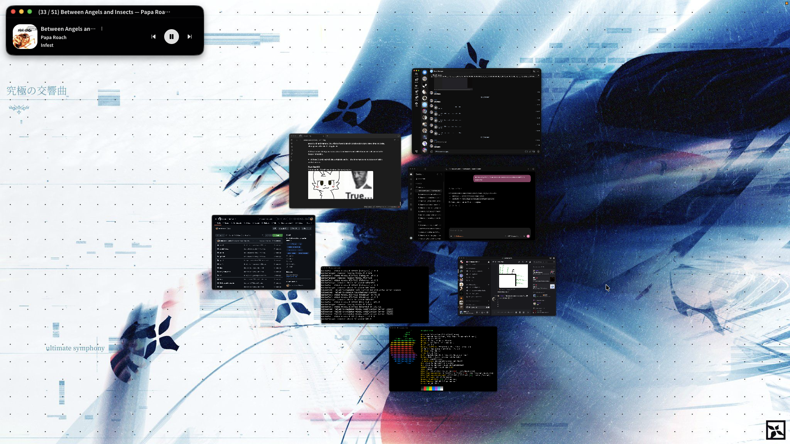

# minfwm



`minfwm` is an infinite 2D window canvas for macOS. It places windows on a virtual desktop that spans connected displays.

> [!WARNING]
> This project is completely vibecoded.

## Installation and usage

> [!IMPORTANT]
> Install the compatible Yabai Scripting Addition separately. Setup requires disabling SIP; see the [Yabai integration guide](https://github.com/snusxd/minfwm/wiki/Yabai-Integration).

Install the latest stable release from the to macOS 14+
[Homebrew tap](https://github.com/snusxd/homebrew-minfwm):

```sh
brew install snusxd/minfwm/minfwm
```

Grant `minfwmd` Accessibility permission in System Settings, then enable the
per-user LaunchAgent:

```sh
minfwm enable
minfwm status
minfwm camera move --x 100 --y 0
```

Use `minfwm start`, `stop`, or `restart` to control the daemon. In a source
checkout, `./build/minfwm dev-update` saves the current virtual window layout and
camera, then restarts the daemon next to that CLI binary. `minfwm reload`
applies configuration changes; `minfwm disable` stops the daemon and removes
login startup.

## Build from source

```sh
cmake -S . -B build -DCMAKE_OSX_DEPLOYMENT_TARGET=14.0
cmake --build build --parallel
ctest --test-dir build --output-on-failure
```

For a foreground run, start `./build/minfwmd`. Keep `minfwmd` beside `minfwm`
when using the LaunchAgent. The daemon socket is `$TMPDIR/minfwm.sock`, owned by
the current user with mode `0600`.

## Features and documentation

See [FEATURES.md](FEATURES.md) for a quick overview of implemented features.
For setup, configuration, and detailed guides, visit the
[project Wiki](https://github.com/snusxd/minfwm/wiki).
