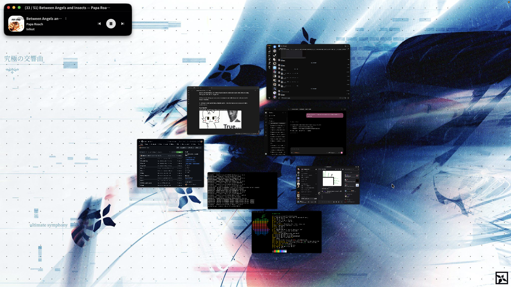

<h1> minfWM</h1>



`minfWM` stands for **m**acOS **inf**inite **W**indow **M**anager – an infinite 2D window canvas for macOS 14+. It turns your desktop into an endless virtual workspace that seamlessly spans across all connected displays.

> [!WARNING]
> This project is completely vibecoded.

## Installation & Quick Start

> [!IMPORTANT]
> `minfWM` requires the custom Yabai Scripting Addition to position windows beyond standard display boundaries. Setup requires disabling SIP; see the [Yabai Integration Guide](https://github.com/snusxd/minfwm/wiki/Yabai-Integration).

### Download

| Architecture | Quick Download |
| --- | --- |
| **Apple Silicon** (M1 / M2 / M3 / M4) | [**Download minfWM-arm64.dmg**](https://github.com/snusxd/minfwm/releases/latest/download/minfWM-arm64.dmg) |
| **Intel** (x86_64) | [**Download minfWM-x86_64.dmg**](https://github.com/snusxd/minfwm/releases/latest/download/minfWM-x86_64.dmg) |

### Setup

1. Open the downloaded `.dmg` and drag **minfWM.app** into **Applications**.
2. Launch **minfWM** and complete the onboarding steps:
   - Grant Accessibility permission in **System Settings → Privacy & Security → Accessibility**.
   - Start the background service from the app settings or menu bar.

*(If the service starts before Accessibility permission is granted, it will wait and start automatically once granted).*

### Useful Commands

| Command | Action |
| --- | --- |
| `minfwm status` | Check if the service is running |
| `minfwm start` / `stop` / `restart` | Control the background service |
| `minfwm reload` | Reload `~/.config/minfwm/minfwm.toml` |
| `minfwm list displays` | List connected displays |
| `minfwm camera move --x 100 --y 0` | Pan the camera via CLI |
| `minfwm disable` | Disable auto-start on login and stop the service |

## Build from Source

```sh
cmake -S . -B build -DCMAKE_OSX_DEPLOYMENT_TARGET=14.0
cmake --build build --parallel
ctest --test-dir build --output-on-failure
```

For foreground testing: `./build/minfwm service`.

During active development, run `./build/minfwm dev-update` to rebuild the binary, preserve open window positions, and smoothly restart the service.

## Features & Documentation

- **[FEATURES.md](FEATURES.md)**: Overview of all built-in features and gestures.
- **[Project Wiki](https://github.com/snusxd/minfwm/wiki)**: Full guides for configuration, shortcuts, architecture, and development.
